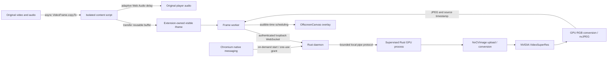

# Architecture

## Rust integration

`src/gpu.rs` loads the public VFX C ABI and nvJPEG dynamically. The small unsafe boundary owns all native pointers; no C/C++ adapter, proprietary headers, or Python runtime is linked. Every GPU object is created, used, synchronized, and destroyed on one OS thread inside a supervised Rust child process. The child explicitly initializes the CUDA driver, retains its primary context, and makes it current before querying/allocating SDK objects. It avoids the upstream cold-context failure.

Input is tightly packed RGBA8 or NV12. NV12 supports limited-range BT.709 / BT.601 and full-range BT.709. The wire parser validates the exact payload length, supported dimensions, finite source timestamp, format, even NV12 dimensions, and 64 MiB bound before FFI calls. GPU RGBA staging, output and RGB encode buffers are reused until dimensions, quality, or format change. AI qualities are 1–4; selector zero/bicubic is never accepted.

The effect selector is `VideoSuperRes` and its quality selector is `QualityLevel`, as used by VFX 1.3. The older public SDK's `SuperRes`/`Mode` API is not an interchangeable fallback. Unsupported runtimes fail explicitly.

The dispatcher passes only bounded raw buffers and JSON metadata over private stdin/stdout pipes. It never sends a page URL or executes shell text. SDK output is consumed on the same CUDA context before its next invocation. nvJPEG output is retrieved after synchronization, so there is no alias to a reused effect buffer. Any inference error drops the engine before a later retry. Image allocation/setup errors also clean up partially created objects via RAII.

## Browser capture and presentation

Cross-origin `VideoFrame` transfer was attempted and did not deliver frames across Chromium's page/extension agent-cluster boundary. The content script therefore calls asynchronous native `VideoFrame.copyTo`, then transfers a reusable ArrayBuffer through a MessageChannel. No pixels are encoded in page JavaScript or sent through `chrome.runtime` messaging. Raw NV12 is preferred when the browser exposes it; other readable SDR formats use explicit RGBA conversion.

An extension-owned **visible** iframe owns the OffscreenCanvas and its dedicated worker. The worker handles transport, JPEG decode, queueing, and drawing. This preserves the reference project's lesson that hidden iframes or cross-cluster canvas ownership can stop animation ticks. GPU decode of JPEG is browser-dependent; we do not claim hardware JPEG decode.

The frame stays under the video's stable ancestor, above the native video branch and below higher DOM controls/captions. Pointer events pass through. The original element remains playing underneath and is never replaced or muted. Hiding/removing the iframe immediately restores the original picture.

Only the largest **visible area intersecting the viewport** among top-level document videos is selected. Ties keep DOM order. The selection is rescanned every 100 ms, covering inserted/replaced videos; a single video changes source/configuration by key. SPA URL changes trigger policy re-evaluation. Cross-origin child frames and shadow roots are intentionally unsupported. Layout transforms, unusual clipping, or an arbitrary site's stacking context cannot be universally certified.

## Timing and backpressure

The original reference uses AV1 NVENC/WebCodecs. Its extra three-frame encoder queue caused roughly 50 ms of delay in one investigated configuration. This project initially chooses GPU JPEG: each submitted image produces one independent packet, without a video encoder's reorder, lookahead, B-frame, or delayed-output queue. The tradeoff is more bandwidth and potentially more browser decode work than NVENC, especially for detailed 4K pictures. No claim of performance superiority is made.

There is one outstanding input per session, a zero-capacity dispatcher channel, one supervised GPU child, one globally active stream, at most eight decoded pictures, and eight pending network/control handlers. The decoded-picture queue is at most about 253 MiB at 4K, plus the current picture/browser buffers. Input/output network messages are capped at 64 MiB. Slow work skips new source frames; it cannot accumulate an unbounded queue. Worker output retains source sequence, epoch, and timestamp. New session generations discard cancelled work; late pictures older than 80 ms relative to audible time are dropped. Future pictures wait until their matching deadline.

The media-input clock derives from `video.currentTime` sampled at frame callbacks, with median filtering and bounded drift correction. It does not double-count the player's `expectedDisplayTime` compensation. Measured capture-to-decode age drives a smoothed Web Audio DelayNode only where the existing device path is insufficient. Unknown zero device latency is not treated as a valid initial observation. Timing implementations are adapted from the reference under MIT, with attribution.

Pause, buffering, seeking, rate changes, visibility loss, source replacement, navigation, and disable remove the overlay and zero added audio delay. A new session establishes a fresh epoch. Native captions/direct video fullscreen/PiP bypass enhancement to preserve original browser behavior. Web Audio cannot fully detach a media-element source; refresh restores the original browser audio route. Real audible synchronization depends on device latency reporting and needs hardware measurement.

`active` requires a fresh worker draw plus a playing, visible selected video. Content code bypasses if freshness is lost, and background code expires an active badge if presentation reports stop. A draw counter does not prove arbitrary site stacking is correct; screenshot testing verifies the shipped fixture's layering.

## Lifecycle and resource ownership

The native-messaging process handles control requests only. A `grant` starts a detached Rust daemon if necessary. An exclusive file lock prevents duplicate daemons. The application uses a private Unix control socket; `start`, `status`, and `stop` address that socket rather than signalling stored PIDs. Status polling does not postpone idle cleanup.

The daemon binds an ephemeral loopback port. A private endpoint file supports diagnostics; browser sessions receive it through native messaging. An object-only teardown test left about 500 MiB in NVIDIA process-global caches. After five seconds without GPU jobs the dispatcher therefore terminates and reaps its owned GPU child, releasing its entire CUDA address space and the SDK caches. A later frame starts a fresh child. This adds a bounded local pipe copy in exchange for reliable VRAM cleanup and fault isolation. The daemon exits after sixty seconds without frame/grant activity. Sessions have short network deadlines. One tab wins the stream lease; competitors receive a clear busy error. There is no implicit cross-tab takeover or stream interleaving.

The GPU child also requests Linux's parent-death signal with a race check. If the control daemon crashes or is killed, the kernel terminates its child instead of leaving an orphaned GPU process.

GPU driver calls cannot be safely interrupted inside FFI. The dispatcher bounds response reads to thirty seconds, then kills and reaps its owned GPU child on timeout/error. The browser restores original playback and can request a fresh worker. No unrelated PID is signalled. A kernel/driver-level uninterruptible process can still require driver recovery; ordinary userspace cancellation cannot repair a wedged kernel. Foreground native diagnostic/benchmark commands run inference directly and should be run under an external timeout when investigating a driver hang.

## Security

- The socket is in a mode-0700 state directory; config and endpoint files are mode 0600. The local user and their trusted programs are inside the trust boundary.
- The native manifest allows only the configured extension ID. The native host also checks Chromium's supplied origin argument.
- An extension content script receives an expiring claim bound to its tab. Only that tab's extension-owned `bridge.html` can claim the native credential. Web pages receive neither the session token nor a permanent shared secret.
- A native session credential is 256 random bits, expires after fifteen seconds, and is consumed once. Outstanding grants are capped.
- WebSocket upgrades require the exact extension origin and `/v1/stream` path. No CORS-enabled media HTTP API or media URL fetcher is exposed. Connections bind only to `127.0.0.1`, never a public address.
- Site access is optional and requested for saved origins. Manual activation uses `activeTab`; no default all-site injection, tab-capture, debugger, or webRequest permission is requested.
- The manifest contains a public identity key, not a signing private key. It stabilizes the unpacked extension ID across install paths. Authentication still relies on browser extension isolation and native messaging, not secrecy of the public ID.
- No telemetry, outgoing media transmission, remote control, or automatic code download occurs during playback. The optional runtime installer downloads NVIDIA software only when explicitly invoked.

The extension and native host both use protocol version 1. Install matching application and extension releases; mismatches fail instead of silently presenting corrupt output.

## TypeScript module design and asset builds

`extension/src/policy.ts` owns site-rule precedence and stale-state expiry through pure functions. `protocol.ts` defines discriminated message types; `messaging.ts` exposes one typed request interface and normalizes errors. The background module retains sender/origin authorization. Types describe the wire contract; they do not replace checks on untrusted input.

`frame-session.ts` is a deep module: starting a session owns its WebSocket, backpressure, bounded decode queue, presentation deadlines and cancellation, returning one stop function. The worker is a small browser adapter. Clock, socket, scheduler and JPEG decoder vary at an internal seam, so tests exercise the same interface without accessing private queues or relying on VM globals. Audio graph construction has its own browser adapter; synchronization and graph reuse stay inside the audio module. Capture and DOM cleanup remain together in the content module because they share one playback lifetime.

Bun bundles these modules for Chromium. The content bundle is an IIFE that preserves idempotent injection; other entry points are browser ES modules. Imported timing classes replace separately injected globals. `bun run build` writes `build/extension`, including static assets/notices. Cargo invokes the same dependency-free build script into its private output directory and embeds only compiled assets. Nix and release ZIPs also use this script; generated JavaScript is never maintained by hand. Bun is a build/development tool and is not needed by installed native applications or browser extensions. Strict `tsc` runs through Bun because transpilation alone does not check types.
