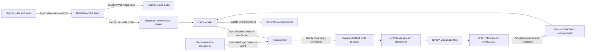

# Architecture

## Rust integration

`src/gpu.rs` owns dynamic VFX, CUDA and NVENC loading and all native pointers. `native/nvenc.c` isolates NVENC versioned structures behind five C functions; the unmodified, MIT-licensed `nvEncodeAPI.h` is vendored from nv-codec-headers n13.0.19.0. Building requires only an ordinary C compiler, no CUDA toolkit or proprietary SDK download. The encoder receives the already-current CUDA context. Every GPU object is created, used, synchronized, and destroyed on one OS thread inside a supervised Rust child process. The child explicitly initializes the CUDA driver, retains its primary context, and makes it current before querying/allocating SDK objects. It avoids the upstream cold-context failure.

Input is tightly packed sRGB RGBA8 or NV12. NV12 supports limited-range BT.709 / BT.601 matrices and full-range BT.709, with Rec.709 primaries/transfer. The wire parser validates the exact payload length, supported dimensions, finite source timestamp, format, even NV12 dimensions, and 64 MiB bound before FFI calls. GPU RGBA staging, output and NV12 encode buffers are reused until dimensions, quality, or format change. AI qualities are 1–4; selector zero/bicubic is never accepted.

The effect selector is `VideoSuperRes` and its quality selector is `QualityLevel`, as used by VFX 1.3. The older public SDK's `SuperRes`/`Mode` API is not an interchangeable fallback. Unsupported runtimes fail explicitly.

The dispatcher moves the WebSocket's owned byte buffer into its job without cloning the payload. Input is copied once into a reusable anonymous 64 MiB Linux memfd shared with the GPU child. Physical pages are allocated on demand. The file is sealed against resizing, inherited only by the owned child, and mapped read-only there. A command over stdin hands off the single input slot; the parent cannot overwrite it until the complete reply arrives. Commands and compressed AV1 output use bounded private pipes. There are no named shared files, page URLs, or executed shell text.

SDK output is consumed on the same CUDA context before its next invocation. GPU NV12 is registered with NVENC once per configuration, mapped per frame, and read only after producer synchronization. Compressed AV1 packets are copied while their bitstream buffer is locked, then unlocked before reuse. Enhanced raw pixels never leave CUDA. Any inference error drops the engine before a later retry. Image allocation/setup errors also clean up partially created objects via RAII.

## Browser capture and presentation

Cross-origin `VideoFrame` transfer was attempted and did not deliver frames across Chromium's page/extension agent-cluster boundary. The content script therefore calls asynchronous native `VideoFrame.copyTo`, then transfers a reusable ArrayBuffer through a MessageChannel. A bounded pool keeps all returned buffers rather than overwriting a single reusable slot when captures overlap. Even rejected captures return their storage. No pixels are encoded in page JavaScript or sent through `chrome.runtime` messaging. Raw NV12 is preferred when its primaries/transfer are Rec.709; other readable SDR formats use Chromium's explicit sRGB RGBA conversion. This avoids reinterpreting SD/wide-gamut primaries or sRGB gamma as Rec.709. PQ/HLG are rejected using WebCodecs' actual transfer names (`smpte2084`, `arib-std-b67`).

NvCVImage converts YUV matrices/range, without converting RGB transfer functions. Encoded output therefore retains sRGB transfer for RGBA input and Rec.709 transfer for native NV12. It uses Rec.709 primaries, limited range, and an explicitly signalled **Rec.601 YUV matrix** with cosited chroma. Rec.601 here is a matrix, not SD primaries or a reduction in resolution/gamut. Both the actual GPU conversion and AV1 metadata use the same matrix. This avoids the additional color error observed in NVIDIA's browser BGRX export path when it applied Rec.601 to Rec.709 YUV despite correct frame metadata. Decoder configuration explicitly supplies matching primaries, transfer, matrix and range; changing transfer starts a new decoder prediction chain. The native `color_space` metadata field identifies the transfer (`srgb` or `bt709`), not the YUV matrix. See [NVIDIA's color flags](https://docs.nvidia.com/maxine/nvcvimage/latest/enumerations.html) and [WebCodecs color configuration](https://www.w3.org/TR/webcodecs/#dom-videodecoderconfig-colorspace).

An extension-owned iframe owns the OffscreenCanvas and its dedicated worker. The worker handles transport, AV1 WebCodecs decode, queueing, and drawing. The overlay stays transparent until a synchronized draw; transparency can suspend Chromium's worker animation callback. Live source-clock messages detect a tick missing for 100 ms, cancel its handle, draw if a fresh picture is due, and re-arm animation. This restores the upstream recovery lesson without adding a permanent polling timer or creating parallel animation loops. Stop cancels the pending handle. The decoder uses `prefer-hardware` and `optimizeForLatency`; supported configuration is checked before decoding. These preferences do not prove that the browser actually selected a hardware decoder. Inspect Media events in performance validation. GPU VideoFrames are drawn directly; there is no JPEG/ImageBitmap stage.

The frame stays under the video's stable ancestor, above the native video branch and below higher DOM controls/captions. Pointer events pass through. The original element remains playing underneath and is never replaced or muted. Hiding/removing the iframe immediately restores the original picture.

Only the largest **visible area intersecting the viewport** among top-level document videos is selected. Ties keep DOM order. The selection is rescanned every 100 ms, covering inserted/replaced videos; a single video changes source/configuration by key. SPA URL changes trigger policy re-evaluation. Cross-origin child frames and shadow roots are intentionally unsupported. Layout transforms, unusual clipping, or an arbitrary site's stacking context cannot be universally certified.

## Timing and backpressure

The original reference found an extra three-frame encoder queue causing roughly 50 ms of delay. The Rust encoder directly uses synchronous NVENC with P1/ultra-low-latency, constant QP 14, no B frames or lookahead. It uses predictive AV1 pictures with a keyframe every 120 encoded pictures, plus a forced keyframe at every connection/configuration restart. This reduces repeated intra-frame work without waiting for future input. It requires output immediately; delayed output is an error. GPU dimensions are checked against real NVENC limits. Actual NVENC picture types determine key/delta metadata; sequence headers on keyframes determine the cached WebCodecs codec string. A decoder rejects a delta as its first picture. Every received packet is decoded in transport order, including pictures subsequently discarded by presentation: dropping encoded reference pictures would corrupt later predictions. WebSocket delivery is ordered/reliable; errors end the session and the next connection starts a new prediction chain. NVIDIA documents this synchronous/PTD mode in its [NVENC programming guide](https://docs.nvidia.com/video-technologies/video-codec-sdk/13.0/nvenc-video-encoder-api-prog-guide/index.html).

There are at most four outstanding inputs per session, further limited by a 32 MiB raw-input budget (or one supported large frame). This allows capture, transport and processing to overlap while limiting larger inputs: four 1080p RGBA/NV12 inputs, two 4K NV12 inputs, one 4K RGBA or 8K NV12 input. Capture and transport share the same limit; decoding also cannot exceed four pending requests. The native dispatcher has one bounded job slot, one GPU child and one globally active stream. A connection awaits its GPU reply before submitting the next job; the slot avoids a false busy error between reply delivery and the next receive. There are at most eight decoded pictures and eight pending network/control handlers. The decoded-picture count is additionally bounded by a 256 MiB NV12 pixel budget (up to eight pictures at 4K, five at 8K), plus current pictures and implementation-specific decoder surfaces. These pixel budgets exclude recycled staging buffers and browser-managed copies/surfaces; they are not a hard bound on whole-browser RAM/VRAM. Input/output network messages are capped at 64 MiB. Slow work skips new source frames; it cannot accumulate an unbounded queue. Worker output retains source sequence, epoch, and timestamp. New session generations discard cancelled work; late pictures older than 80 ms relative to audible time are dropped. Future pictures wait until their matching deadline.

The media-input clock derives from `video.currentTime` sampled at frame callbacks, with median filtering and bounded drift correction. It does not double-count the player's `expectedDisplayTime` compensation. Measured capture-to-decode age calibrates a Web Audio delay only where the existing device path is insufficient. Calibration collects at least twelve observations over 400 ms while an undelayed path plays. The initial delay is configured while muted, then gains crossfade over 20 ms. Later delay adjustments have an 8 ms deadband and at most 0.5% clock slew, instead of rapid per-frame exponential retuning. Bypass crossfades back to the undelayed path before resetting the now-inaudible delay buffer; repeated bypass events do not restart automation. Explicit gain-ramp start anchors also handle interrupted fades. Unknown zero device latency is not treated as a valid initial observation. Timing implementations are adapted from the reference under MIT, with attribution.

Pause cancels capture, freezes the clock, discards queued/pending presentation surfaces and holds the last painted picture. Pending predictive packets are still decoded to retain references. Quick resume reuses the iframe, socket and decoder. Audio retains its calibrated delay while clearing pre-pause latency samples: counting a pause as calibration time could introduce a large delay and a second picture stall. After 1.5 paused seconds, the stream lease and decoder close, below the native three-second read deadline, while one static canvas remains visible. GPU idle cleanup continues normally. A later session retires that canvas only after its first actual draw, or after a 350 ms resume grace if startup is slow. `video-overlay.ts` owns parent positioning through reference-counted leases, allowing either side of a cancelled handoff to close first. A short decode underrun can similarly hold the picture for 350 ms (plus the 100 ms reconciliation interval); it cannot keep an active badge alive. Slow cold resume may briefly show the original moving picture rather than freezing indefinitely.

Buffering, seeking, rate changes, visibility loss, source replacement, navigation, errors and disable remove all overlays and zero added audio delay promptly. A new session establishes a fresh epoch. Native captions/direct video fullscreen/PiP bypass enhancement to preserve original browser behavior. Web Audio cannot fully detach a media-element source; refresh restores the original browser audio route. Real audible synchronization depends on device latency reporting and needs hardware measurement.

`active` requires a fresh worker draw plus a playing, visible selected video. Draws continue at video rate while presentation reports are coalesced to 10 Hz, reducing page-side layout checks and statistics cloning. Initial/recovered presentation and stale transitions report immediately. The report carries the actual draw's wall timestamp; a report delayed over 200 ms cannot turn the overlay or badge active. Content code bypasses if freshness is lost, and background code expires an active badge if presentation reports stop. A draw counter does not prove arbitrary site stacking is correct; screenshot testing verifies the shipped fixture's layering.

## Lifecycle and resource ownership

The native-messaging process handles control requests only. A `grant` starts a detached Rust daemon if necessary. An exclusive file lock prevents duplicate daemons. The application uses a private Unix control socket; `start`, `status`, and `stop` address that socket rather than signalling stored PIDs. Status polling does not postpone idle cleanup.

The daemon binds an ephemeral loopback port. A private endpoint file supports diagnostics; browser sessions receive it through native messaging. An object-only teardown test left about 500 MiB in NVIDIA process-global caches. After five seconds without GPU jobs the dispatcher therefore terminates and reaps its owned GPU child, releasing its entire CUDA address space and the SDK caches. The shared input mapping is released too. A later frame starts a fresh child. Process isolation retains reliable VRAM cleanup without piping raw pixels through the kernel. The daemon exits after sixty seconds without frame/grant activity. Sessions have short network deadlines. One tab wins the stream lease; competitors receive a clear busy error. There is no implicit cross-tab takeover or stream interleaving.

The GPU child also requests Linux's parent-death signal with a race check. If the control daemon crashes or is killed, the kernel terminates its child instead of leaving an orphaned GPU process.

GPU driver calls cannot be safely interrupted inside FFI. The dispatcher bounds response reads to thirty seconds, then kills and reaps its owned GPU child on timeout/error. The browser restores original playback and can request a fresh worker. No unrelated PID is signalled. A kernel/driver-level uninterruptible process can still require driver recovery; ordinary userspace cancellation cannot repair a wedged kernel. Foreground native diagnostic/benchmark commands run inference directly and should be run under an external timeout when investigating a driver hang.

## Security

- The socket is in a mode-0700 state directory; config and endpoint files are mode 0600. The local user and their trusted programs are inside the trust boundary.
- The native manifest allows only the configured extension ID. The native host also checks Chromium's supplied origin argument.
- An extension content script receives an expiring claim bound to its tab. Only that tab's extension-owned `bridge.html` can claim the native credential. Web pages receive neither the session token nor a permanent shared secret.
- A native session credential is 256 random bits, expires after fifteen seconds, and is consumed once. Outstanding grants are capped.
- WebSocket upgrades require the exact extension origin and `/v1/stream` path. No CORS-enabled media HTTP API or media URL fetcher is exposed. Connections bind only to `127.0.0.1`, never a public address.
- YouTube HTTPS origins have declared access and automatic rules by default. Other site access is optional and requested for saved origins. Explicit false site rules persist across upgrades. Manual activation uses `activeTab`; no default all-site injection, tab-capture, debugger, or webRequest permission is requested.
- The manifest contains a public identity key, not a signing private key. It stabilizes the unpacked extension ID across install paths. Authentication still relies on browser extension isolation and native messaging, not secrecy of the public ID.
- No telemetry, outgoing media transmission, remote control, or automatic code download occurs during playback. The optional runtime installer downloads NVIDIA software only when explicitly invoked.

The extension and native host both use streaming protocol version 3. Version 2 expected only independent keyframes; it is rejected before GPU processing. Install matching application and extension releases; mismatches fail instead of silently presenting corrupt output.

## TypeScript module design and asset builds

`extension/src/policy.ts` owns site-rule precedence and stale-state expiry through pure functions. `protocol.ts` defines discriminated message types; `messaging.ts` exposes one typed request interface and normalizes errors. The background module retains sender/origin authorization. Types describe the wire contract; they do not replace checks on untrusted input.

`frame-session.ts` is a deep module: starting a session owns its WebSocket, backpressure, bounded decode queue, presentation deadlines and cancellation, returning one stop function. The worker is a small browser adapter. Clock, socket, scheduler and packet decoder vary at an internal seam, so tests exercise the same interface without accessing private queues or relying on VM globals. Audio graph construction has its own browser adapter; synchronization and graph reuse stay inside the audio module. Capture and DOM cleanup remain together in the content module because they share one playback lifetime.

Bun bundles these modules for Chromium. The content bundle is an IIFE that preserves idempotent injection; other entry points are browser ES modules. Imported timing classes replace separately injected globals. `bun run build` writes `build/extension`, including static assets/notices. Cargo invokes the same dependency-free build script into its private output directory and embeds only compiled assets. Nix and release ZIPs also use this script; generated JavaScript is never maintained by hand. Bun is a build/development tool and is not needed by installed native applications or browser extensions. Strict `tsc` runs through Bun because transpilation alone does not check types.

## Output targets

The popup selects 720p, 1080p, 1440p, 2160p (4K), or experimental 4320p (8K). `resolution.ts` fits the source inside 16:9 bounds, or swapped bounds for portrait, then aligns down to eight pixels. Source aspect ratio is preserved within that alignment; there is no stretching to fill a different aspect ratio. Equal/larger sources bypass. Browser settings store the target rather than a fixed multiplier. Existing site/global/quality settings remain; older scale-only settings adopt the default 4K target. The native parser independently limits output to 7680 on either axis and 7680×4320 total pixels. NVENC and VFX may have lower hardware/model limits and fail explicitly. Input is still capped at 64 MiB: 8K NV12 fits, 8K RGBA does not.
